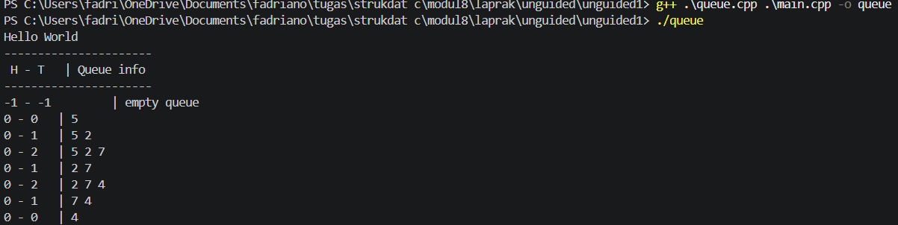
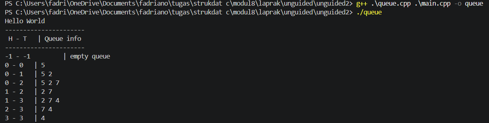
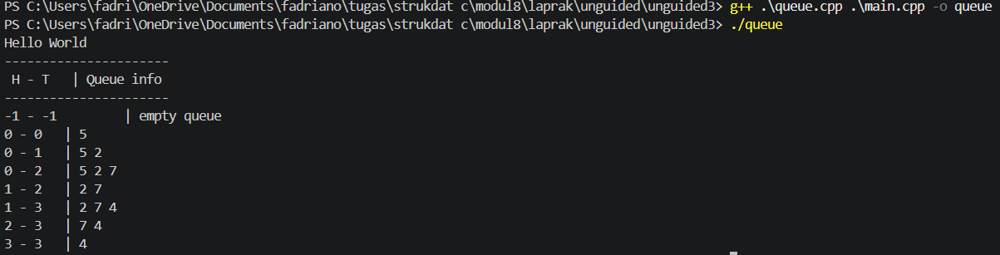

# <h1 align="center">Laporan Praktikum Modul 8 Struktur Data </h1>
<p align="center">Fadriano Bumindra Abiyyu - 109082500170</p>

## Dasar Teori
### A. Queue <br/>
Queue adalah struktur data linier yang bekerja dengan prinsip FIFO (First In First Out), yaitu elemen yang pertama masuk adalah elemen yang pertama keluar[1][3]. Penambahan elemen dilakukan di bagian belakang (tail) dan penghapusan elemen dilakukan di bagian depan (head)[3].
#### 1. Enqueue
Enqueue adalah operasi menambahkan elemen baru pada bagian belakang queue[1].
#### 2. Dequeue
Dequeue adalah operasi menghapus elemen pada bagian depan queue[1].
### B. Representasi Queue <br/>
Queue dapat dibuat dengan dua representasi.
#### 1. Representasi pointer
Queue disusun dari elemen yang saling terhubung lewat pointer next, dengan pointer Head dan Tail sebagai penanda, sehingga ukurannya dapat berubah[3].
#### 2. Representasi tabel (Array)
Queue disimpan dalam array dengan jumlah elemen yang terbatas, dan data pada array dapat dikelompokkan dengan struct[2][3]. Terdapat tiga alternatif, yaitu Head diam dan Tail bergerak, Head dan Tail sama-sama bergerak, serta Head dan Tail berputar (circular)[3].

## Guided 1

### queue.h

```C++
#ifndef QUEUE_H_INCLUDE
#define QUEUE_H_INCLUDE

#include <iostream>
using namespace std;

#define Nil NULL

typedef int infotype;
typedef bool boolean;

typedef struct elmQ *address;

struct elmQ {
    infotype info;
    address next;
};

/* Deklarasi tipe data queue */
struct queue {
    address head;
    address tail;
};

/********* Pengecekan apakah queue kosong *********/
boolean isEmpty(queue Q);
/* Mengembalikan true jika queue kosong */

/********* Pembuatan queue kosong *********/
void CreateQueue(queue &Q);
/* I.S. sembarang
   F.S. terbentuk queue kosong */

/********* Manajemen memori *********/
address alokasi(infotype X);
/* Mengirimkan address hasil alokasi elemen.
   Jika berhasil, mengembalikan address baru.
   Jika gagal, mengembalikan Nil */

void dealokasi(address P);
/* I.S. P terdefinisi
   F.S. memori yang digunakan P dikembalikan ke sistem */

/********* Pencarian elemen *********/
address findElm(queue Q, infotype X);
/* Mencari elemen dengan info = X.
   Jika ditemukan mengembalikan address elemen,
   jika tidak mengembalikan Nil */

boolean fFindElm(queue Q, address P);
/* Mencari apakah elemen dengan alamat P ada dalam queue.
   Mengembalikan true jika ada, false jika tidak */

/********* Penambahan elemen *********/
void insert(queue &Q, address P);
/* I.S. P sudah dialokasikan
   F.S. P ditambahkan pada akhir queue */

/********* Penghapusan elemen *********/
void deleteQueue(queue &Q, address &P);
/* I.S. queue tidak kosong
   F.S. P menunjuk elemen pertama queue,
        head berpindah ke elemen berikutnya.
        Queue mungkin menjadi kosong */

/********* Proses semua elemen queue *********/
void printInfo(queue Q);
/* Menampilkan seluruh isi queue */

int nbList(queue Q);
/* Mengembalikan jumlah elemen queue */

void delAll(queue &Q);
/* Menghapus seluruh elemen queue dan dealokasi memori */

#endif
```
Kode tersebut berisi deklarasi tipe data dan prototype fungsi untuk queue dengan representasi pointer, yaitu struct elmQ sebagai elemen dan struct queue yang memiliki pointer head dan tail. File ini juga memuat deklarasi fungsi seperti insert, deleteQueue, printInfo, dan delAll.

### queue.cpp

```C++
#include "queue.h"

boolean isEmpty(queue Q) {
    return (Q.head == Nil);
}

void CreateQueue(queue &Q) {
    Q.head = Nil;
    Q.tail = Nil;
}

address alokasi(infotype X) {
    address P = new (nothrow) elmQ;
    if (P != Nil) {
        P->info = X;
        P->next = Nil;
    }
    return P;
}

void dealokasi(address P) {
    delete P;
}

address findElm(queue Q, infotype X) {
    address P = Q.head;
    while (P != Nil) {
        if (P->info == X) {
            return P;
        }
        P = P->next;
    }
    return Nil;
}

boolean fFindElm(queue Q, address P) {
    address R = Q.head;
    while (R != Nil) {
        if (R == P) {
            return true;
        }
        R = R->next;
    }
    return false;
}

void insert(queue &Q, address P) {
    if (isEmpty(Q)) {
        Q.head = P;
        Q.tail = P;
    } else {
        (Q.tail)->next = P;
        Q.tail = P;
    }
}

void deleteQueue(queue &Q, address &P) {
    P = Q.head;
    if (Q.head == Q.tail) {
        Q.head = Nil;
        Q.tail = Nil;
    } else {
        Q.head = P->next;
    }
    P->next = Nil;
}

void printInfo(queue Q) {
    if (isEmpty(Q)) {
        cout << "Queue kosong" << endl;
    } else {
        address P = Q.head;
        while (P != Nil) {
            cout << P->info << " ";
            P = P->next;
        }
        cout << endl;
    }
}

int nbList(queue Q) {
    int jumlah = 0;
    address P = Q.head;
    while (P != Nil) {
        jumlah++;
        P = P->next;
    }
    return jumlah;
}

void delAll(queue &Q) {
    address P;
    while (!isEmpty(Q)) {
        deleteQueue(Q, P);
        dealokasi(P);
    }
}
```
Kode tersebut berisi implementasi fungsi-fungsi pada queue pointer. Fungsi insert menambahkan elemen di bagian tail, deleteQueue mengambil elemen dari bagian head, sedangkan findElm, nbList, dan delAll digunakan untuk mencari, menghitung, dan menghapus seluruh elemen.

### main.cpp 

```C++
#include <iostream>
#include "queue.h"
using namespace std;

int main() {
  queue Q;
  address P;

  CreateQueue(Q);
  cout << "isEmpty : " << isEmpty(Q) << endl;
  printInfo(Q);

  insert(Q, alokasi(5));
  insert(Q, alokasi(2));
  insert(Q, alokasi(7));
  cout << "Setelah insert 5, 2, 7" << endl;
  printInfo(Q);
  cout << "nbList : " << nbList(Q) << endl;

  P = findElm(Q, 2);
  if (P != Nil) {
    cout << "findElm(2) ketemu, info = " << P->info << endl;
    cout << "fFindElm : " << fFindElm(Q, P) << endl;
  }

  deleteQueue(Q, P);
  cout << "Setelah delete, elemen yang keluar = " << P->info << endl;
  dealokasi(P);
  printInfo(Q);

  delAll(Q);
  cout << "Setelah delAll" << endl;
  printInfo(Q);
  cout << "isEmpty : " << isEmpty(Q) << endl;

  return 0;
}
```
Kode tersebut berisi program utama yang membuat queue, menambahkan elemen 5, 2, dan 7, lalu mencari elemen 2. Setelah itu program menghapus elemen yang dicari, menghapus seluruh isi queue dengan delAll, dan menampilkan hasilnya.

## Guided 2

### queue.h

```C++
#ifndef QUEUE_H
#define QUEUE_H

#include <iostream>
using namespace std;

const int MAKSIMAL = 5;

struct queue {
    string nama[MAKSIMAL];
    int head;
    int tail;
};

bool isFull(queue Q);
bool isEmpty(queue Q);
void CreateQueue(queue &Q);
void enQueue(queue &Q, string nama);
void deQueue(queue &Q);
void viewQueue(queue Q);

#endif
```
Kode tersebut berisi deklarasi struct queue dengan array nama berukuran MAKSIMAL, serta penanda head dan tail. File ini juga memuat prototype fungsi isFull, isEmpty, CreateQueue, enQueue, deQueue, dan viewQueue.

### queue.cpp

```C++
#include "queue.h"
#include <iostream>

using namespace std;

// NOTE : 
// Implementasi 1 = head diam, tail bergerak (Queue Linear Statis, kerana head nya tetap diam)
// Implementasi 2 = head bergerak, tail bergerak (Queue Linear Dinamis, karena head & tail nya sama-sama bergerak)
// Implementasi 3 = head dan tail berputar (Queue Circular, karena jika udh mentok tapi masih ada space, diputar sehingga tail bisa ada didepan head)

bool isEmpty(queue Q){
    if(Q.head == -1 && Q.tail == -1){
        return true;
    } else {
        return false;
    }
}

//isFull implmenetasi 1 & 2
bool isFull(queue Q){
    if(Q.tail == MAKSIMAL - 1){
        return true;
    } else {
        return false;
    }
}

// //isFull implementasi 3
// bool isFull(queue Q){
//     if((Q.tail + 1) % MAKSIMAL == Q.head){
//         return true;
//     } else {
//         return false;
//     }
// }

void CreateQueue(queue &Q){ //terbentuk queue dengan head = -1 dan tail = -1 
    Q.head = -1;
    Q.tail = -1;
}
 

//enqueue implementasi 1 & 2
void enQueue(queue &Q, string nama){
    if(isFull(Q) == true){
        cout << "Queue sudah penuh!" << endl;
    } else {
        if(isEmpty(Q) == true){
            Q.head = Q.tail = 0;
        } else {
            Q.tail++;
        }
        Q.nama[Q.tail] = nama;
        cout << "nama " << nama << " berhasil ditambahkan kedalam queue!" << endl;
    }
}

// //enQueue implementasi 3
// void enQueue(queue &Q, string nama){
//     if(isFull(Q) == true){
//         cout << "Queue sudah penuh!" << endl;
//     } else {
//         if(isEmpty(Q) == true){
//             Q.head = Q.tail = 0;
//         } else {
//             Q.tail = (Q.tail + 1) % MAKSIMAL; // bergerak melingkar
//         }
//         Q.nama[Q.tail] = nama;
//         cout << "nama " << nama << " berhasil ditambahkan kedalam queue!" << endl;
//     }
// }

//dequeue implementasi 1
void deQueue(queue &Q){
    if(isEmpty(Q) == true){
        cout << "Queue kosong!" << endl;
    } else {
        cout << "Mengahapus data " << Q.nama[Q.head] << "..." << endl;
        for(int i = 0; i < Q.tail; i++){
            Q.nama[i] =  Q.nama[i+1];
        }
        Q.tail--;
        if(Q.tail < 0){ //kalo semua isi queue nya udh dikelaurin, set head & tail ke -1
            Q.head = -1;
            Q.tail = -1;
        }
    }
}

// //dequeue implementasi 2
// void deQueue(queue &Q){
//     if(isEmpty(Q) == true){
//         cout << "Queue kosong!" << endl;
//     } else {
//         cout << "Mengahapus data " << Q.nama[Q.head] << "..." << endl;
//         Q.head++;
//         if(Q.head > Q.tail){ //kalo elemennya udh abis (head akan lebih 1 dari tail), maka reset ulang head & tail ke -1
//             Q.head = -1;
//             Q.tail = -1;
//         }
//     }
// }

// //deQueue implementasi 3
// void deQueue(queue &Q){
//     if(isEmpty(Q) == true){
//         cout << "Queue kosong!" << endl;
//     } else {
//         cout << "Mengahapus data " << Q.nama[Q.head] << "..." << endl;
//         if(Q.head == Q.tail){ //kalo elemennya tinggal 1, langsungkan saja head & tail nya reset ke -1
//             Q.head = -1;
//             Q.tail = -1;
//         } else {
//             Q.head = (Q.head + 1) % MAKSIMAL; // bergerak melingkar
//         }
//     }
// }

//viewQueue implementasi 1 & 2
void viewQueue(queue Q){
    if(isEmpty(Q) == true){
        cout << "Queue kosong!" << endl;
    } else {
        for(int i = Q.head; i <= Q.tail; i++){
            cout << i -  Q.head + 1 << ". " << Q.nama[i] << endl;
        }
    }
    cout << endl;
}

// //viewQueue implementasi 3
// void viewQueue(queue Q){
//     if(isEmpty(Q) == true){
//         cout << "Queue kosong!" << endl;
//     } else {
//         int i = Q.head;
//         int count = 1;
//         while(true){
//             cout << count << ". " << Q.nama[i] << endl;
//             if(i == Q.tail){
//                 break;
//             }
//             i = (i + 1) % MAKSIMAL;
//             count++;
//         }   
//     }
// }
```
Kode tersebut berisi implementasi fungsi queue dengan representasi array. Terdapat tiga alternatif implementasi, dan yang digunakan adalah implementasi 1 (Head diam, Tail bergerak), sehingga deQueue menggeser elemen ke kiri.

### main.cpp 

```C++
#include "queue.h"
#include <iostream>

using namespace std;

int main(){
    queue Q;

    CreateQueue(Q);
    enQueue(Q, "Dimas");
    enQueue(Q, "Arvin");
    enQueue(Q, "Rizal");
    enQueue(Q, "Hafizh");
    enQueue(Q, "Fathur");
    enQueue(Q, "Daffa");
    cout << endl;

    cout << "--- Isi Queue Setelah enQueue ---" << endl;
    viewQueue(Q);
    cout << endl;

    deQueue(Q);
    deQueue(Q);
    deQueue(Q);
    deQueue(Q);
    // deQueue(Q);
    // deQueue(Q);
    cout << endl;

    cout << "--- Isi Queue Setelah deQueue ---" << endl;
    viewQueue(Q);

    return 0;
}
```
Kode tersebut berisi program utama yang menambahkan enam nama ke dalam queue, kemudian menampilkan isinya. Karena ukuran queue hanya lima, nama terakhir ditolak, lalu program menghapus empat data dan menampilkan sisa isi queue.

## Unguided 

### 1.  Buatlah ADT Queue menggunakan ARRAY sebagai berikut di dalam file “queue.h”. Buatlah implementasi ADT Queue pada file “queue.cpp” dengan menerapkan mekanisme queue Alternatif 1 (head diam, tail bergerak).

### queue.h

```C++
#ifndef QUEUE_H
#define QUEUE_H

#include <iostream>
using namespace std;

typedef int infotype;

struct Queue {
    infotype info[5];
    int head;
    int tail;
};

void createQueue(Queue &Q);
bool isEmptyQueue(Queue Q);
bool isFullQueue(Queue Q);
void enqueue(Queue &Q, infotype x);
infotype dequeue(Queue &Q);
void printInfo(Queue Q);

#endif
```
### queue.cpp
```C++
#include "queue.h"

void createQueue(Queue &Q) {
    Q.head = -1;
    Q.tail = -1;
}

bool isEmptyQueue(Queue Q) {
    return (Q.head == -1 && Q.tail == -1);
}

bool isFullQueue(Queue Q) {
    return (Q.tail == 4);
}

void enqueue(Queue &Q, infotype x) {
    if (isFullQueue(Q)) {
        cout << "Queue penuh" << endl;
    } else {
        if (isEmptyQueue(Q)) {
            Q.head = 0;
            Q.tail = 0;
        } else {
            Q.tail++;
        }
        Q.info[Q.tail] = x;
    }
}

infotype dequeue(Queue &Q) {
    infotype x = -1;
    if (isEmptyQueue(Q)) {
        cout << "Queue kosong" << endl;
    } else {
        x = Q.info[Q.head];
        for (int i = 0; i < Q.tail; i++) {
            Q.info[i] = Q.info[i + 1];
        }
        Q.tail--;
        if (Q.tail < 0) {
            Q.head = -1;
            Q.tail = -1;
        }
    }
    return x;
}

void printInfo(Queue Q) {
    cout << Q.head << " - " << Q.tail << " \t| ";
    if (isEmptyQueue(Q)) {
        cout << "empty queue" << endl;
    } else {
        for (int i = Q.head; i <= Q.tail; i++) {
            cout << Q.info[i] << " ";
        }
        cout << endl;
    }
}
```
### main.cpp

```C++
#include "queue.h"

int main() {
    cout << "Hello World" << endl;
    Queue Q;
    createQueue(Q);

    cout << "----------------------" << endl;
    cout << " H - T \t | Queue info" << endl;
    cout << "----------------------" << endl;
    printInfo(Q);
    enqueue(Q, 5); printInfo(Q);
    enqueue(Q, 2); printInfo(Q);
    enqueue(Q, 7); printInfo(Q);
    dequeue(Q); printInfo(Q);
    enqueue(Q, 4); printInfo(Q);
    dequeue(Q); printInfo(Q);
    dequeue(Q); printInfo(Q);

    return 0;
}
```

##### Output


Kode tersebut berisi implementasi queue array dengan Head yang selalu berada di indeks 0 dan Tail yang bergerak ke kanan saat enqueue. Pada dequeue, semua elemen digeser ke kiri sehingga Tail berkurang satu.

### 2. Buatlah implementasi ADT Queue pada file “queue.cpp” dengan menerapkan mekanisme queue Alternatif 2 (head bergerak, tail bergerak).

### queue.h
```C++
#ifndef QUEUE_H
#define QUEUE_H

#include <iostream>
using namespace std;

typedef int infotype;

struct Queue {
    infotype info[5];
    int head;
    int tail;
};

void createQueue(Queue &Q);
bool isEmptyQueue(Queue Q);
bool isFullQueue(Queue Q);
void enqueue(Queue &Q, infotype x);
infotype dequeue(Queue &Q);
void printInfo(Queue Q);

#endif
```
### queue.cpp
```C++
#include "queue.h"

void createQueue(Queue &Q) {
    Q.head = -1;
    Q.tail = -1;
}

bool isEmptyQueue(Queue Q) {
    return (Q.head == -1 && Q.tail == -1);
}

bool isFullQueue(Queue Q) {
    return (Q.head == 0 && Q.tail == 4);
}

void enqueue(Queue &Q, infotype x) {
    if (isFullQueue(Q)) {
        cout << "Queue penuh" << endl;
    } else {
        if (isEmptyQueue(Q)) {
            Q.head = 0;
            Q.tail = 0;
        } else {
            if (Q.tail == 4) {
                int selisih = Q.head;
                for (int i = Q.head; i <= Q.tail; i++) {
                    Q.info[i - selisih] = Q.info[i];
                }
                Q.head = 0;
                Q.tail = Q.tail - selisih;
            }
            Q.tail++;
        }
        Q.info[Q.tail] = x;
    }
}

infotype dequeue(Queue &Q) {
    infotype x = -1;
    if (isEmptyQueue(Q)) {
        cout << "Queue kosong" << endl;
    } else {
        x = Q.info[Q.head];
        Q.head++;
        if (Q.head > Q.tail) {
            Q.head = -1;
            Q.tail = -1;
        }
    }
    return x;
}

void printInfo(Queue Q) {
    cout << Q.head << " - " << Q.tail << " \t| ";
    if (isEmptyQueue(Q)) {
        cout << "empty queue" << endl;
    } else {
        for (int i = Q.head; i <= Q.tail; i++) {
            cout << Q.info[i] << " ";
        }
        cout << endl;
    }
}
```
### main.cpp
```C++
#include "queue.h"

int main() {
    cout << "Hello World" << endl;
    Queue Q;
    createQueue(Q);

    cout << "----------------------" << endl;
    cout << " H - T \t | Queue info" << endl;
    cout << "----------------------" << endl;
    printInfo(Q);
    enqueue(Q, 5); printInfo(Q);
    enqueue(Q, 2); printInfo(Q);
    enqueue(Q, 7); printInfo(Q);
    dequeue(Q); printInfo(Q);
    enqueue(Q, 4); printInfo(Q);
    dequeue(Q); printInfo(Q);
    dequeue(Q); printInfo(Q);

    return 0;
}
```

##### Output


Kode tersebut berisi implementasi queue array dengan Head dan Tail yang sama-sama bergerak. Pada dequeue, Head maju satu indeks, dan saat Tail mencapai batas, elemen digeser ke depan jika masih ada ruang kosong.

### 3. Buatlah implementasi ADT Queue pada file “queue.cpp” dengan menerapkan mekanisme queue Alternatif 3 (head dan tail berputar).

### queue.h
```C++
#ifndef QUEUE_H
#define QUEUE_H

#include <iostream>
using namespace std;

typedef int infotype;

struct Queue {
    infotype info[5];
    int head;
    int tail;
};

void createQueue(Queue &Q);
bool isEmptyQueue(Queue Q);
bool isFullQueue(Queue Q);
void enqueue(Queue &Q, infotype x);
infotype dequeue(Queue &Q);
void printInfo(Queue Q);

#endif
```

### queue.cpp
```C++
#include "queue.h"

void createQueue(Queue &Q) {
    Q.head = -1;
    Q.tail = -1;
}

bool isEmptyQueue(Queue Q) {
    return (Q.head == -1 && Q.tail == -1);
}

bool isFullQueue(Queue Q) {
    return (!isEmptyQueue(Q) && (Q.tail + 1) % 5 == Q.head);
}

void enqueue(Queue &Q, infotype x) {
    if (isFullQueue(Q)) {
        cout << "Queue penuh" << endl;
    } else {
        if (isEmptyQueue(Q)) {
            Q.head = 0;
            Q.tail = 0;
        } else {
            Q.tail = (Q.tail + 1) % 5;
        }
        Q.info[Q.tail] = x;
    }
}

infotype dequeue(Queue &Q) {
    infotype x = -1;
    if (isEmptyQueue(Q)) {
        cout << "Queue kosong" << endl;
    } else {
        x = Q.info[Q.head];
        if (Q.head == Q.tail) {
            Q.head = -1;
            Q.tail = -1;
        } else {
            Q.head = (Q.head + 1) % 5;
        }
    }
    return x;
}

void printInfo(Queue Q) {
    cout << Q.head << " - " << Q.tail << " \t| ";
    if (isEmptyQueue(Q)) {
        cout << "empty queue" << endl;
    } else {
        int i = Q.head;
        while (true) {
            cout << Q.info[i] << " ";
            if (i == Q.tail) {
                break;
            }
            i = (i + 1) % 5;
        }
        cout << endl;
    }
}
```
### main.cpp
```C++
#include "queue.h"

int main() {
    cout << "Hello World" << endl;
    Queue Q;
    createQueue(Q);

    cout << "----------------------" << endl;
    cout << " H - T \t | Queue info" << endl;
    cout << "----------------------" << endl;
    printInfo(Q);
    enqueue(Q, 5); printInfo(Q);
    enqueue(Q, 2); printInfo(Q);
    enqueue(Q, 7); printInfo(Q);
    dequeue(Q); printInfo(Q);
    enqueue(Q, 4); printInfo(Q);
    dequeue(Q); printInfo(Q);
    dequeue(Q); printInfo(Q);

    return 0;
}
```

##### Output


Kode tersebut berisi implementasi queue array melingkar dengan operasi modulo. Head dan Tail kembali ke indeks 0 setelah mencapai batas, sehingga ruang kosong di depan dapat dipakai kembali.

## Kesimpulan
Queue adalah struktur data yang bekerja dengan prinsip FIFO, yaitu data yang pertama masuk akan pertama keluar. Pada praktikum ini queue dibuat dengan representasi pointer dan representasi array, kemudian array dibuat dalam tiga alternatif, yaitu Head diam, Head dan Tail bergerak, serta circular. Hasil percobaan menunjukkan bahwa alternatif pertama memerlukan penggeseran elemen, sedangkan alternatif kedua dan ketiga lebih efisien karena Head ikut bergerak.

## Referensi
[1] Trijayanti, A., Aulia, I., Khairunisa, N., Purba, F. A. H., & Gunawan, I. (2025). "Implementasi Struktur Data Antrian Queue dalam Sistem Penjadwalan Proses pada Sistem Operasi". Jurnal Publikasi Teknik Informatika, Vol. 4, No. 2, Mei 2025, hlm. 48-53. DOI: https://doi.org/10.55606/jupti.v4i2.4170. Diakses pada 23 November 2026 melalui https://journalcenter.org/index.php/jupti/article/download/4170/3305/15514. <br> 
[2] Maylova, R. A., Noviana, N., Abdussalam, A., Pramudya, E. R., & Muslih, M. (2025). "Sistem Manajemen Data Mahasiswa Berbasis Pemrograman C++ untuk Efisiensi Administrasi Akademik". Jurnal Aplikasi Teknologi dan Komputasi, Vol. 1, No. 3, hlm. 24-33. Diakses pada 23 November 2026 melalui https://journals.arces.org/jatekom/article/view/83. <br> 
[3] Fakultas Informatika, Telkom University. (n.d.). "Modul 8: Queue". Modul Praktikum Struktur Data. Informatics Lab.